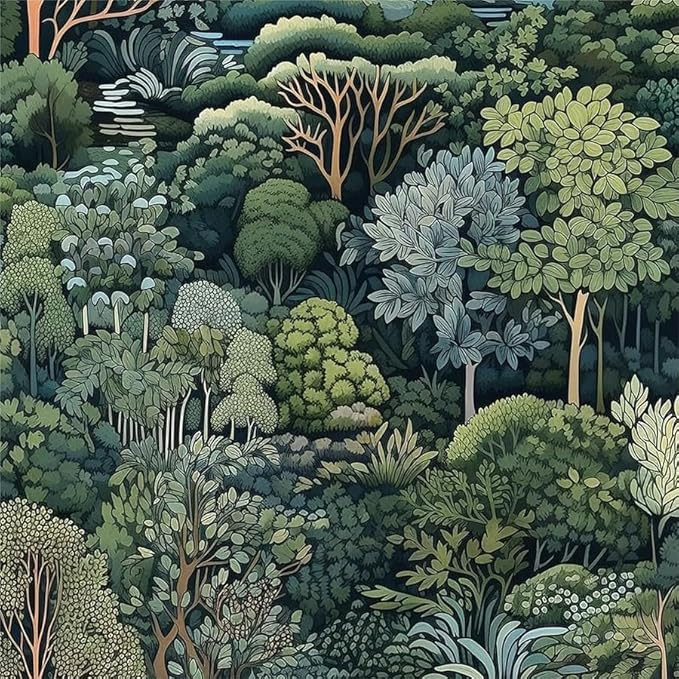

COGS118B Project: Generating Pareidolia-Like Images
[(Final Paper here)](https://docs.google.com/document/d/1-pcOFWrzsAmjc9ygW8T4bUDgL5WeRSuYHVSEhIV5bg4/edit?usp=sharing)

<table>
  <tr>
    <td align="center">
      
       
      <b>Before</b>
    </td>
    <td align="center">
      
       
      <b>After</b>
    </td>
  </tr>
</table>